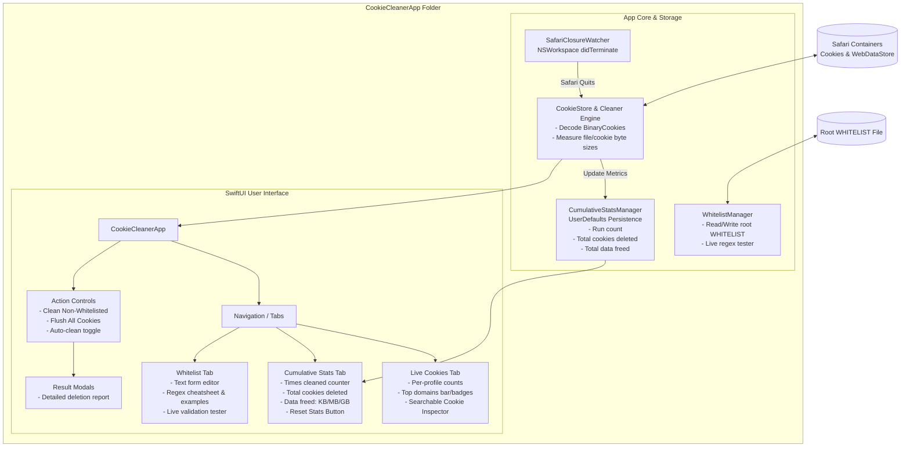

# Implementation Plan: Standalone Cookie Cleaner macOS SwiftUI App (V2)

Build a dedicated, standalone macOS SwiftUI application located in its own folder (`CookieCleanerApp/`), keeping the existing command-line interface (`Sources/cookie-cleaner/`) and its build configuration completely untouched.

---

## Key Differences from Initial Plan

1. **Zero Impact on CLI**: Existing `Sources/cookie-cleaner/`, `Package.swift`, `clean_cookies`, and `Makefile` remain completely unmodified.
2. **Dedicated App Directory (`CookieCleanerApp/`)**: The entire UI application lives in `CookieCleanerApp/` with its own `Package.swift` and standalone build lifecycle.
3. **Cumulative Statistics Pane**: A dedicated metrics view tracking:
   - **Total times cleaned** (automatic on Safari quit + manual runs).
   - **Total cookies deleted** across all sessions.
   - **Total data freed** (cumulative bytes/MB saved from cookie records + erased cache/storage).
   - **"Reset Statistics" button** with confirmation to clear historical data.
   - Persistent storage via `UserDefaults`.

---

## Application Architecture



---

## Directory & File Structure

```text
cookie-cleaner/
├── clean_cookies                    # UNTOUCHED
├── Makefile                         # UNTOUCHED
├── Package.swift                    # UNTOUCHED
├── WHITELIST                        # Shared whitelist file
├── Sources/
│   ├── cookie-cleaner/              # UNTOUCHED CLI
│   ├── BinaryCodable/               # Vendored library
│   └── BinaryCookies/               # Vendored library
│
└── CookieCleanerApp/                # [NEW] Isolated UI App Directory
    ├── Package.swift                # Standalone SPM package for the UI app
    ├── Makefile                     # Build & bundle commands for the app
    └── Sources/
        └── CookieCleanerApp/
            ├── App/
            │   ├── CookieCleanerApp.swift       # @main SwiftUI App entry point
            │   └── AppState.swift               # Observable coordinator
            ├── Models/
            │   ├── CookieItem.swift             # Identifiable model for UI tables
            │   ├── CleaningResult.swift         # Structured result for popups
            │   └── CumulativeStats.swift        # Codable historical metrics model
            ├── Services/
            │   ├── CookieStore.swift            # Cookie parsing, stats, delete logic
            │   ├── CumulativeStatsManager.swift # Run counts, cookies deleted, bytes freed
            │   ├── WhitelistManager.swift       # Editor, regex validation & guide
            │   └── SafariClosureWatcher.swift   # NSWorkspace background watcher
            └── Views/
                ├── MainView.swift               # Main window layout with tab bar
                ├── LiveCookiesView.swift        # Profile stats, top domains, cookie list
                ├── CumulativeStatsView.swift    # Cleaning counter, data freed, reset button
                ├── WhitelistEditorView.swift    # Text editor + regex cheatsheet & tester
                ├── Components/
                │   ├── TopDomainsView.swift     # Visual domain distribution
                │   ├── CookieTableView.swift    # Searchable/filterable cookie table
                │   └── StatCardView.swift       # Modern metric cards
                └── Modals/
                    └── ActionSummaryAlert.swift # Completion popups (Clean & Flush)
```

---

## Detailed Component Specifications

### 1. Cumulative Statistics Pane (`CumulativeStatsView.swift`)
- **Metric Cards**:
  - **Times Cleaned**: Integer counter displaying total automated + manual cleaning triggers.
  - **Total Cookies Deleted**: Running sum of cookies removed.
  - **Total Data Freed**: Dynamically formatted string (`KB`, `MB`, `GB`) representing disk space recovered.
  - **Last Cleaned Date**: Timestamp of the most recent operation.
- **Reset Button**:
  - Styled with a warning tint.
  - Triggers an `NSAlert` confirmation: *"Are you sure you want to reset all historical cleaning statistics to zero?"*.
  - Immediately zeroes out counts in `CumulativeStatsManager`.

### 2. Live Cookie Stats & Inspection (`LiveCookiesView.swift`)
- **Profile Summary**:
  - Profile cards (e.g., Default Profile, Profile 1 `[UUID]`).
  - Total cookies per profile.
- **Top Domains**:
  - Horizontal bar gauges and counts for the top 10 cookie sources.
- **Full Cookie Table**:
  - Real-time search by domain or cookie name.
  - Filter by profile and status (Whitelisted vs To-Be-Deleted).
  - Columns: Status Icon (Green/Red), Domain, Name, Path, Expiry Date, Profile.

### 3. Whitelist Editor & Regex Guidelines (`WhitelistEditorView.swift`)
- **Text Editor**: Direct view of the shared `WHITELIST` file with Save and Reload actions.
- **Regex Guide & Cheatsheet**:
  - Explanations of anchors: why `(^|\.)domain\.com$` avoids tracking subdomains.
  - One-click copy/insert template chips:
    - Exact Domain & Subdomains: `(^|\.)domain\.com$`
    - Subdomain Only: `^auth\.domain\.com$`
    - Multiple TLDs: `(^|\.)amazon\.(com|fr)$`
- **Live Domain Tester**:
  - Text input where user types a URL/domain (e.g. `px.ads.linkedin.com` or `github.com`).
  - Real-time green/red indicator indicating if the current whitelist allows it.

### 4. Background Safari Closure Watcher (`SafariClosureWatcher.swift`)
- Uses `NSWorkspace.shared.notificationCenter` observing `.didTerminateApplicationNotification`.
- When Safari quits (`com.apple.Safari`):
  - Checks if "Auto-clean on Safari Quit" toggle is enabled.
  - Runs cookie cleaning in background.
  - Updates `CumulativeStatsManager` (increments cleaning run count, cookies deleted, and data freed).
  - Refreshes live stats and shows a subtle macOS notification or status bar banner.

### 5. Action Buttons & Popups (`ActionSummaryAlert.swift`)
- **"Clean Non-Whitelisted" Button**:
  - Deletes all non-matching cookies and clears profile caches.
  - Pops up a summary sheet:
    - Total cookies deleted.
    - Total cookies left adhering to whitelist.
    - Disk space freed.
    - Per-profile breakdown.
- **"Flush All Cookies" Button**:
  - Deletes all cookies across all profiles.
  - Requires confirmation prompt.
  - Shows completion popup with count of wiped cookies.
- **"Refresh" Button**: Immediately re-reads Safari cookie databases.

---

## Verification Plan

### Automated Build Verification
```bash
# 1. Verify CLI remains completely functional and untouched
swift build -c release

# 2. Build the new standalone UI application
cd CookieCleanerApp
swift build -c release
```

### Manual Verification Checklist
1. **CLI Untouched**: Run `./clean_cookies` or existing CLI binary; verify behavior is unchanged.
2. **Launch UI App**: Launch `CookieCleanerApp`; verify Safari cookies, profile counts, and top domains render.
3. **Inspect Cookies**: Test search filter and verify whitelisted vs non-whitelisted color indicators.
4. **Cumulative Stats**:
   - Check initial counters (0 runs or restored from storage).
   - Perform a clean action; verify "Times Cleaned", "Total Cookies Deleted", and "Data Freed" increment.
   - Click "Reset Stats"; confirm all historical values reset to zero.
5. **Whitelist Form & Tester**:
   - Add/edit a pattern in the text editor and click Save.
   - Test `github.com` vs `badtracker.com` in the live regex tester.
6. **Action Popups**:
   - Trigger "Clean Non-Whitelisted" -> Verify modal displays deleted/remaining count.
   - Trigger "Flush All Cookies" -> Verify warning prompt and final confirmation modal.
7. **Background Safari Watcher**:
   - Toggle Auto-clean ON.
   - Open Safari, browse, and quit Safari (`Cmd+Q`).
   - Confirm the app detects the closure, executes cleaning, and increments cumulative stats.
